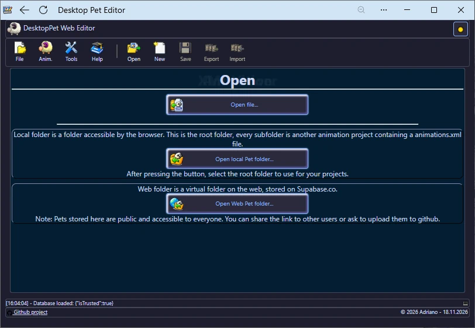
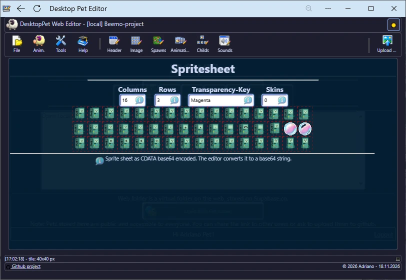
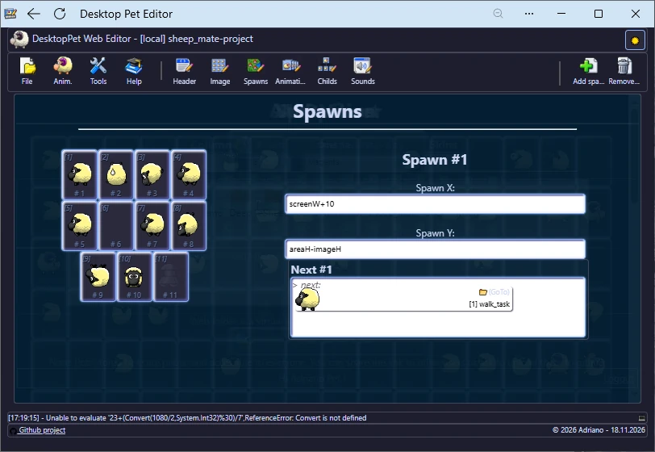

# DesktopPet Editor

**A browser-based editor for creating and managing DesktopPet animation projects.**

> **Beta:** The editor's core functionality is ready to use. Resource links and a dedicated editor for pet `README.md` files are still planned.

DesktopPet Editor makes it easier to create, edit, test, and prepare pets for [DesktopPet](https://github.com/Adrianotiger/desktopPet), the Windows desktop-pet application inspired by the classic eSheep. Instead of editing the project's XML by hand, use the visual editors and save the result in the format DesktopPet uses.

## Preview

## A look inside the editor

Open an XML file or choose a local project folder to get started:

Set up the spritesheet by choosing its grid, transparency color, and skins:

Then configure where the pet appears and which animation it starts with:

## Open the editor

Use the hosted editor—there is no installer:

**[Launch DesktopPet Editor](https://adrianotiger.github.io/desktopPet-Editor/)**

The editor runs in a modern browser. To open and save an entire local project folder, use a browser that supports the File System Access API; the tutorials recommend Chrome, Edge, or Opera for this workflow. You can also open and edit a single XML file.

## What you can do

- **Create or open projects** using the built-in template, an XML file, or a local project folder.
- **Edit pet metadata** such as author, title, pet name, version, description, and icon.
- **Set up spritesheets** by uploading an image and configuring its grid, transparency color, and skins.
- **Build behavior** with spawn points, animations, frame sequences, transitions, children, and sounds.
- **Use formulas** for supported position and behavior values.
- **Review the generated XML** in the XML Viewer.
- **Save and test changes**, including saving a local project with optional backups and exporting XML for drag-and-drop testing with a running DesktopPet.
- **Prepare project files** by generating a basic `README.md` or `icon.png` when either is missing from a local project.

The editor works with the DesktopPet XML format. It does not publish projects to GitHub for you; review and upload your project files to your repository yourself.

## Quick start

1. [Open the editor](https://adrianotiger.github.io/desktopPet-Editor/).
2. In **File**, open an existing `animations.xml` or local project folder, or choose **New** to start from the template.
3. Use the **Anim.** sections to edit the header, image, spawns, animations, children, and sounds.
4. Save your changes from **File**. For a local project, you can choose to back up the existing animation file.
5. Use **Export** to generate XML for testing, or inspect the result in **XML Viewer**.

For publishing a pet, a project folder typically includes `animations.xml`, `README.md`, and `icon.png`. The local project save tools can generate a basic README and icon from the project data if they are missing.

## Documentation

The editor includes help and tutorials in the `help/` folder:

- [Application tutorial](help/tutorial_app.md) — menus and a typical editing workflow
- [File tutorial](help/tutorial_editor_file.md) — opening, saving, importing, and exporting
- [Animation editor tutorial](help/tutorial_editor_anim.md) — header, spritesheet, and animation data
- [XML tutorial](help/tutorial_xml.md) — the structure of DesktopPet animation files
- [All tutorials](help/tutorial.md)
- [Help overview](help/help.md)

## Related projects

- [DesktopPet](https://github.com/Adrianotiger/desktopPet) — the Windows application that uses these pet projects
- [Available pets](https://adrianotiger.github.io/desktopPet/Pets/) — browse released pets
- [DesktopPet Editor source](https://github.com/Adrianotiger/desktopPet-Editor)

## License

DesktopPet Editor is released under the [MIT License](LICENSE).
