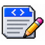
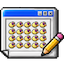
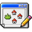
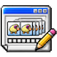
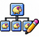
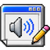
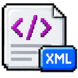

# Tutorial 1: Using the application

A quick, visual guide to the editor's tabs and the main steps for creating or updating a pet project.

## A typical workflow

1. **Open** an existing project, or create one from the built-in template.
2. **Add project details** in Header and load a spritesheet in Image.
3. **Build behavior** with spawns, animations, children, and sounds.
4. **Review and save** your changes. Use XML Viewer to inspect the result.

## Use the menu bar

The menu bar is organized into four groups. Some editing actions become available after you open or create a project.

- **File** — **Open** an XML file or project folder, **New** project from the built-in template, and **Save** your current changes.
- **Anim.** — open the project editing tabs: **Header**, **Image**, **Spawns**, **Animations**, **Childs**, and **Sounds**.
- **Tools** — open the **XML viewer** to inspect the project source and its current edited version.
- **Help** — open **Tutorial**, **Help**, **Info**, **Credits**, and **License**.

The icons on the right side of the menu bar are actions for the current tab. For example, the animation editor offers **Delete**, **Save&Close**, and **Close**.

## Open, create, and save

To start, choose **Open** and select an XML file or a project folder containing a valid `animations.xml`, or choose **New** to start from the built-in template. When a project loads, the editor rebuilds its XML data and enables the editing tabs. Choose **Save** to write the current project back to its file or project folder.

> **Tip:** Check the XML Viewer if you want to confirm how your edits are represented before saving.

## Set up the pet

###  Header

Add the details that identify your project:

- **Author**, **Title**, **PetName**, and **Version**
- **Icon** — upload a 48 × 48 image
- **Info** — add a short description or reuse notes

The icon is stored in the XML as a base64 image string.

###  Image / Spritesheet

Load the PNG spritesheet and set its grid:

- **Columns** (`tilesx`) and **Rows** (`tilesy`)
- **Transparency key**
- **PNG image**

The canvas overlays a grid so you can preview the frame cells. Make sure the row and column counts match the image; incorrect settings can make frames look stretched or broken.

## Define how the pet appears

###  Spawns

A spawn is an entry point: it sets where the pet appears and which animation starts.

Select a spawn to edit its **X** and **Y** position, starting animation, probability, and next animation. Add or remove spawns as needed. A simple project may use one spawn for its usual position and connect it to an idle or movement animation.

## Create movement and behavior

###  Animations

The Animations tab shows each animation as a tile with its ID, name, and a small animated preview. Select a tile to open its animation editor. Use **Add animation** to create an animation; rename an animation in its editor. Delete an animation there when it is no longer needed. An animation that is still referenced by another part of the project cannot be deleted until those references are removed.

#### Animation editor

The animation editor opens when you select an animation tile. It has a preview and controls for the animation's identity, frames, motion, and transitions:

- **Animation Key** — view the animation ID and edit its unique name. Click the preview to pause or play it.
- **Sequence** — view and arrange the sprite frames in playback order. Click a frame to choose a different spritesheet cell; drag frames to reorder them or drag one to the trash to remove it. Use **＋** to add a frame.
- **Repeats / From** — set how many times the sequence repeats and the frame index where the loop restarts (`repeatfrom`).
- **End action** — choose what happens when the frame sequence finishes.
- **Parameters start / end** — set X and Y movement, **Offset Y**, **Interval** (timing), and **Opacity** at the beginning and end of the animation.
- **Next sequence**, **Next border**, and **Next gravity** — configure possible follow-up animations for sequence completion, border behavior, and gravity behavior. Add or remove transitions and set their probability and any available condition.

Use **Save&Close** to apply the animation edits and return to the Animations list. **Close** exits the editor; if there are unsaved changes, you can save, discard, or cancel closing. **Delete** removes the animation only when no other animation or project element refers to it.

###  Childs

Child entries describe secondary objects attached to the pet, such as accessories, effects, or floating companions. Add a child, assign its animation ID, set its X and Y offsets relative to the pet, and choose its next action.

###  Sounds

Add an MP3 sound and associate it with an animation ID. Each entry has a probability setting, so a sound can play occasionally rather than every time.

## Review the project

###  XML Viewer

Compare the original XML with the current version to see how the editor's controls map to the project file. This is also useful for checking animation logic and spotting unexpected values.

## Find help

The **Help** menu links to the tutorials, Help, Info, Credits, and License pages.

## Before you finish

- Check that the spritesheet grid matches your image.
- Confirm each spawn points to the intended starting animation.
- Preview animation sequences and transitions.
- Review the XML, then save your project.
