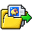
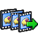
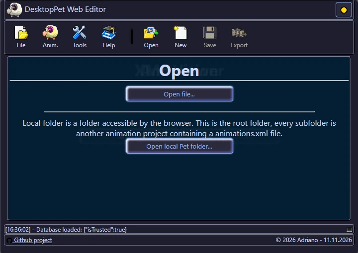
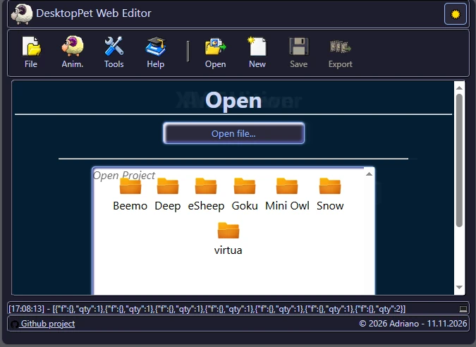
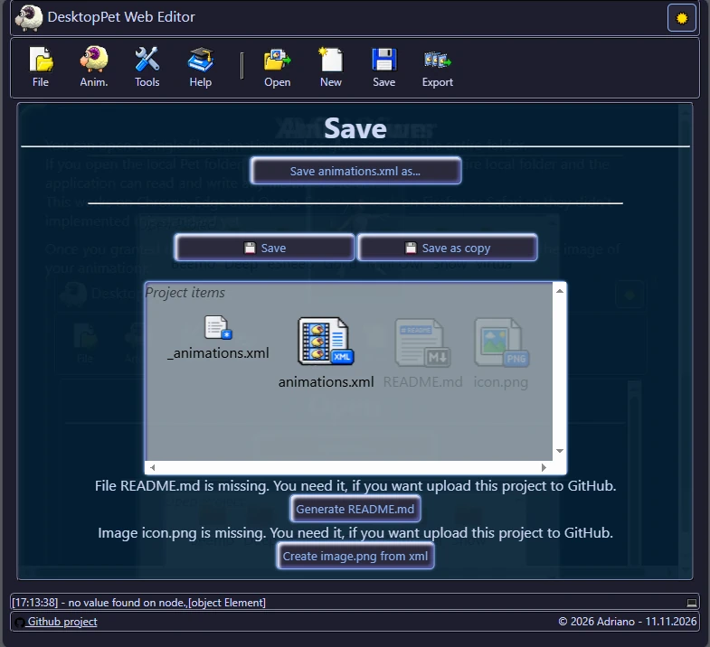

#  Tutorial: File Menu

A quick, visual guide to the file menu functionality.

-  [Open file or project](../help/tutorialEditorFile.md#Open)
-  Start by template animation
-  Save file or project
-  Export or test

# Open

You can open a single file `animations.xml` or give access to the entire folder. 
If you open the local Pet folder, you have to give access to the entire local folder and the application can read and write any file on this folder.  
This works on Chrome, Edge and Opera. Does not work on Firefox or Safari as they didn't implemented this standard yet.

Once you granted the access, you will see your folders (if icon.png is present, the image of your animation): 
  

The folder handler will be saved in the application, so you don't need to select it on each start.

Press on a project or open the animations.xml manually to load the XML in this editor.

# New

New will load a template with just 2-3 animations. Perfect to start a new animations.

# Save

You can save the new animation with another name or you can save the animations.xml in your project folder.  

**Github note:**
- To upload it to GitHub, you need a README.md, animations.xml and icon.png files.
- README.md and icon.png can be generated from this application if they are missing in the folder.
- animations copy will have a number [YYMMDD].xml. Don't worry, they are not uploaded to GitHub!

