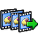
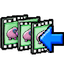
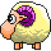
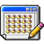
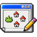
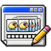
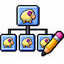

# App Tutorial: Using the application

A quick, visual guide to the editor's tabs and the main steps for creating or updating a pet project.

## A typical workflow

1. **Open** an existing project, or create one from the built-in template.
2. **Add project details** in Header and load a spritesheet in Image.
3. **Build behavior** with spawns, animations, children, and sounds.
4. **Review and save** your changes. Use XML Viewer to inspect the result.

## Use the menu bar

###  File Menu

-  [Open file or project](../help/tutorial_editor_file.md#Open)
-  [Start by template animation](../help/tutorial_editor_file.md#New)
-  [Save file or project](../help/tutorial_editor_file.md#Save)
-  [Export or test](../help/tutorial_editor_file.md#Export)
-  [Import XML](../help/tutorial_editor_file.md#Import)

###  Edit Animation

-  [Edit header](../help/tutorial_editor_anim.md#Header)
-  [Edit spritesheet](../help/tutorial_editor_anim.md#Image)
-  [Edit spawns](../help/tutorial_editor_anim.md#Spawns)
-  Edit animations
-  Edit edit childs
-  Edit sounds

