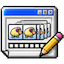
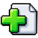
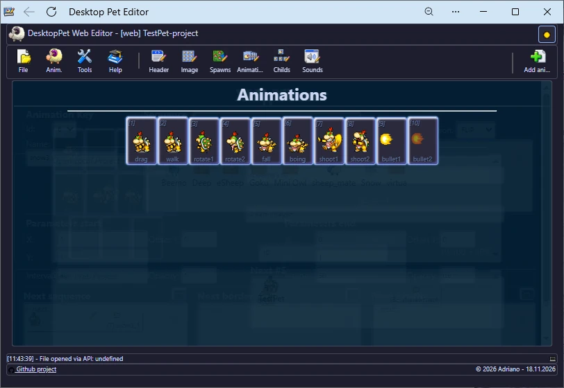
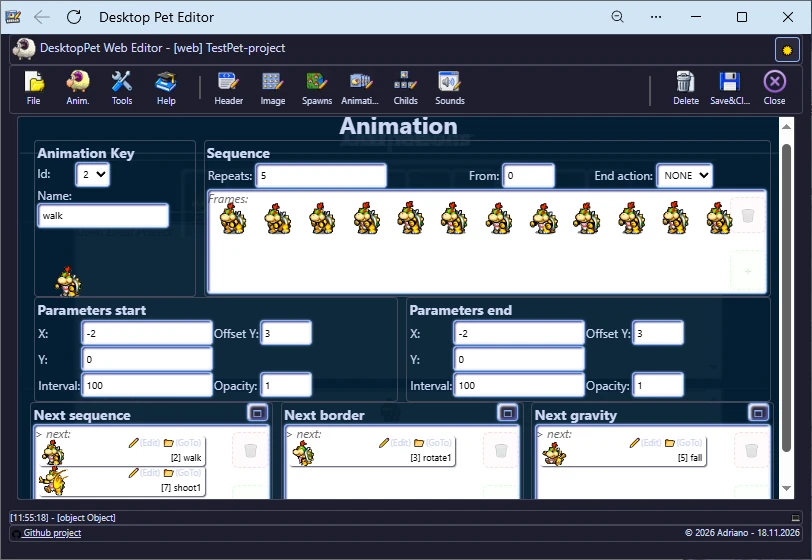
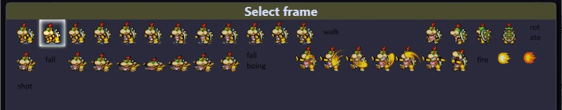
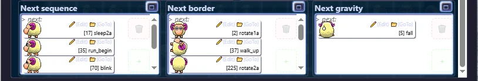
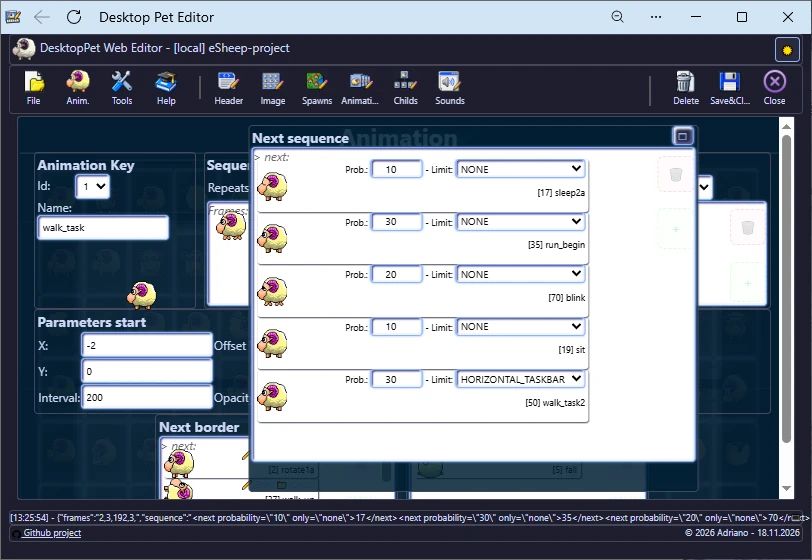

#  Tutorial: Animation Menu

A visual guide to the animation menu.

-  [Header block](../help/tutorial_editor_anim.md#Header)
-  [Spritesheet block](../help/tutorial_editor_anim.md#Spritesheet)
-  [Spawns block](../help/tutorial_editor_anim.md#Spawns)
-  [Animations block](../help/tutorial_editor_anim.md#Animations)
-  [Children block](../help/tutorial_editor_anim.md#Children)
-  [Sounds block](../help/tutorial_editor_anim.md#Sounds)
---

The editor provides a graphical interface for editing the XML file. It loads the XSD schema from GitHub to validate the structure and provide contextual help:

Move the pointer over an icon to display dynamic help. The help text is maintained in the [Resources folder](https://github.com/Adrianotiger/desktopPet/tree/master/Resources).

Most properties are saved directly in the XML. **Remember to save the XML from the File menu.**
Some properties, such as those in the animation block, are saved only after selecting `Save`.

## Header

### Author
Enter your name or nickname.
### Title
Enter the project name. This name should match the folder name and is displayed when users download the pet.
### Petname
Enter the pet name. It appears in the tray icon and when spawning a new pet.
### Version
Enter a version string, such as `0.1` for a beta or `1.0` for a released project.
### Application
This value is currently `1` and must remain unchanged. It will be increased to `2` if a future application version becomes incompatible with this XML format.
### Info
Enter the text displayed by the application's About menu. The supported formatting is limited:
- Use `[br]` for a line break.
- Use `[link:https://example.com]` for a link.
- Other HTML-style tags are not supported.
### Icon
Choose the icon displayed in Windows when the pet starts. The icon is stored as a Base64-encoded file in the XML.

Requirements:
- Use a Windows `.ico` file, not a PNG or JPG.
- Use a 48 x 48 pixel image.

If you upload a PNG, the editor converts it to the required format and resizes it to 48 x 48 pixels.

## Spritesheet

The spritesheet is stored as a Base64-encoded string in the XML file.
Select `Upload` to import a spritesheet image, then configure the following parameters:
### Columns/Rows
Enter the number of columns and rows in the spritesheet. The image dimensions must be exact multiples of the frame size.
For example, a 10 x 10 pixel frame cannot fit in a 98 x 100 pixel spritesheet. The editor displays an error when the dimensions are invalid.
An external image editor is currently required to prepare sprites.

### Transparency Key
DesktopPet uses a transparent color, implemented by Windows Forms, to render the spritesheet. The image must use one opaque, designated color for transparency; alpha channels and antialiasing are not supported.
Magenta is the default because it is uncommon in artwork. Another Windows color name may be selected; see [System.Windows.Media.Colors](https://learn.microsoft.com/en-us/dotnet/api/system.windows.media.colors).

### Skins
Use skins when the same animations are available in several color variants. Set this value to `0` or `1` for a single skin, or enter the number of skins to divide the spritesheet into corresponding groups.
For example, a 20 x 10 spritesheet contains 200 frames. With four skins, each skin has 50 frames. Add the animations only for the first skin; DesktopPet selects a random skin when the pet starts.

## Spawns

Configure the location where the pet appears and the animation that plays after spawning.

This block requires at least one animation.

###  Add Spawn
Select this button to add another spawn location. At least one spawn is required.
For multiple locations, use Probability to control how frequently each location is selected.

### Spawn X / Spawn Y
Set the spawn X and Y coordinates. Each field accepts a formula; select it to open the `formula editor`.

### Probability
Enter an integer weight for this spawn location. It is not a percentage; DesktopPet combines all weights into a probability distribution.
For example, if the total weight is 100, a weight of 1 selects this spawn once in approximately every 100 spawns.

### Next
The next animation to play, once it was spawn at the configured position. See `next editor`.  
- click on the image to changethe animation
- click on "GoTo" to open this animation

## Animations

This is the most important block. Every animation (like an animated gif) is configurated here.  
Each animation has an ID used to play and to identify it. For the editor, you have to set also a name for each animation. Some names are keywords used for special actions:
- `drag`: this animation is played automatically, if a user drag the pet with the mouse
- `toss`: this animation is played automatically, if a user toss the pet around the screen (after drag)
- `kill`: set an animation (max 1 second) to play, once the pet is removed from windows
- `sync`: this animation is played when the user press the "cancel" button in the about box
- `fall`: if gravity is detected and no animation is set for it, this will be used as standard animation. If fall is not used, the pet has no gravita (for example Neko).
- `fall soft`, `fall hard`: are played automatically, after a pet was tossed and a border is detected

For a good animation, `drag` and `kill` should be used. `sync` and `toss` are "nice to have".  

***Direction***
When you edit this animations, move the pet to **only one direction**. There is an action "Flip" that will play all your animations to the opposite direction to use (for example if a border was detected). Use this feature, instead of creating 2 animations for each direction.  
The Sheep always go from right to left (japanese convention), but you can choose the direction you want.  

The main screen shows all animations that are present in your file (with the ID):

Once you click on an animation, you can edit it:  

Now, get a break or drink a glass of water, as this is the most complex part and not easy to understand!  

### Animation Key
As already written, every animation has an ID. When you link an animation to some actions, the ID is taken. So this number is really important and shouldn't be changed in the XML. When you create a new animation, this ID is incremented. You can't delete an animation until there are some linked nodes to it.  
The `name` is more a user friendly word to describe the animation. It should be unique.  

### Sequence
To create the animation, you need to set the frames to be played (exactly like on a gif). You can use the same frame many times, if you want.
- To add a frame, press the `+`-sign on the right.
- To delete a frame, move the image on the trash
- To edit the frame, click on the image, a selection-window will appear:  

***Repeats***
You can choose to repeat the animation for more than 1 time, before the next animation will be played.  
It is a loop and you can set the number of loops in this field. You can insert a number or a formula.  

***Repeat From***
If the frames are repeated, you can set the start-frame when the first sequence is over. It will be looped from this frame until the end.  

***End Action***
Once the sequence is over, you can choose an action to play. Currently, only 2 actions are available:  
- NONE: default
- FLIP: All animations and images will be flipped and played mirrored. If the pet was moving left, now it will move to the right.

### Parameters START / END
The sequence is played frame per frame, until the sequence is over. You can set the movement for the first frame and the movement for the last frame.  
All other frames are interpolated.  
Example [start / end] with 10 frames:  
- X: [2 / 2]
- Y: [-5 / 5]
- offset: [0 / 0]
- interval: [100 / 100]  

This is a typical jump movement, it will move to the right for 2 pixels and move up for 5 pixels after the first frame.  
After this, X will continue to be 2 until the end (like offset and interval) but Y will be interpolated with this formula:  
`y = startY+((endY-startY)/frames)*frame = -5+((5--5)/10)*frame = -5+(10/10)*frame = -5 + 1*frame`  
As it has 10 frames, each frame has another Y-value:
- frame 1: -5
- frame 2: -5+1 = -4
- frame 3: -5+2 = -3
- frame 4: -5+3 = -2
- frame 5: -5+4 = -1
- frame 6: -5+5 = 0
- frame 7: -5+6 = 1
- frame 8: -5+7 = 2
- frame 9: -5+8 = 3
- frame 10: -5+9 = 4

Note: if you use `repeat` and/or `from`, the number of frames is calculated in this way:  
`frames = total_frames + (total_frames - from) * repeats`  
Example frames: 10 - repeat from: 4, repeats: 1. `frames = 10 + (10-4)*1 = 10 + 6 = 16`

***X,Y***
The movement in X and Y. X is the direction to right ⇒. Y the direction to the bottom ⇓. They can also be parsed as formula.

***Interval***
The delay until the next frame is played. It should be smooth but not too fast. 20ms is really fast, so use 40 or 50 if possible or 100 if speed is not requested. This value can be a formula.  

***Offset***
This is the Y offset. Sometimes a pet detects a border and you want to overlap this border or fly over the border. Then you can set this offset to place the pet over or under the detected border (for example Negima).  

***Opacity***
This value will set an alpha over the entire pet. 1 is visible, 0 is invisible. Set a value between 0 and 1 and the animation will interpolate it from the start value up to the end value.  

### NEXT (Sequence, Border, Gravity)
 

The sequence can be played until the end, but it can also break:
- if drag is detected
- if gravity is detected
- if border is detected  

Normally, the sequence is over without a break. At this point a `next sequence` animation will be selected to be played.  
If a border (can be window, screen or taskbar) is detected, the animation will break and the `next border` animation will be loaded/played.  
If gravity is present and the pet is in the "air", `next gravity` animation will be played. If there is an animation called `fall`, this animation will be played automatically if no `next gravity` is defined.  

To edit the next animation, press on the 🗖-icon to maximize this section (or press the 🖉-icon).  
  
You can add more than one `next-node`. The application will take one randomly.  
Set the probability for each node. It is not really a percent; if the sum of all probability is 100, then you have a percent value ;)  But it is a little bit more complicated.  
- press on the image, to select the next animation to play. A window will all animations be be shown.
- write a number for the probability to be executed.
- select if this node should be limited to a particular border

There are many flags to set for the limit. The value you can set for each next-type are: 
- Sequence next:
  - `none`: default, play without any limit
  - `horizontal taskbar`: only if the pet is on the taskbar
  - `horizontal window`: only if the pet is on a window
  - `horizontal screen`: only if the pet is on the screen border
  - `horizontal all`: only if it is on the taskbar or window
  - ~~`vertical window`: only if it is on the vertical window~~
  - ~~`vertical screen`: only if on the screen border~~
  - ~~`vertical pet`: only if on another pet~~
  - ~~`vertical all`: on any vertical border~~
- Border next:
  - `none`: pet hit any border (window, taskbar or screen)
  - `horizontal taskbar`: pet hit the horizontal taskbar
  - `horizontal window`: pet hit the window or **reached the end of the window**
  - `horizontal screen`: pet hit the screen border
  - `horizontal all`: pet hit window or taskbar
  - `vertical window`: pet hit a window side
  - `vertical screen`: pet hit screen side
  - `vertical pet`: pet hit another pet
  - `vertical all`: pet hit another pet or window
- Gravity next:
  - `none`: default, play without any limit
  - ~~`horizontal taskbar`: only if the pet is on the taskbar~~
  - ~~`horizontal window`: only if the pet is on a window~~
  - ~~`horizontal screen`: only if the pet is on the screen border~~
  - ~~`horizontal all`: only if it is on the taskbar or window~~
  - ~~`vertical window`: only if it is on the vertical window~~
  - ~~`vertical screen`: only if on the screen border~~ 
  - ~~`vertical pet`: only if on another pet~~
  - ~~`vertical all`: on any vertical border~~

If you have 3 `next sequence` with `none 20`, `none 20` and `taskbar 20` and the pet is on a window, the total for probability will be 40 and not 60.  
At this point, you have 50% probability for the first animation and 50% probability for the second animation. The last animation will not be used for the calculation of probability.  
If the per is on the taskbar, all 3 are used and so you have 33% for each animation to be played (as the total is 60 and probability 20).

