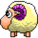
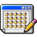
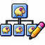
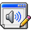
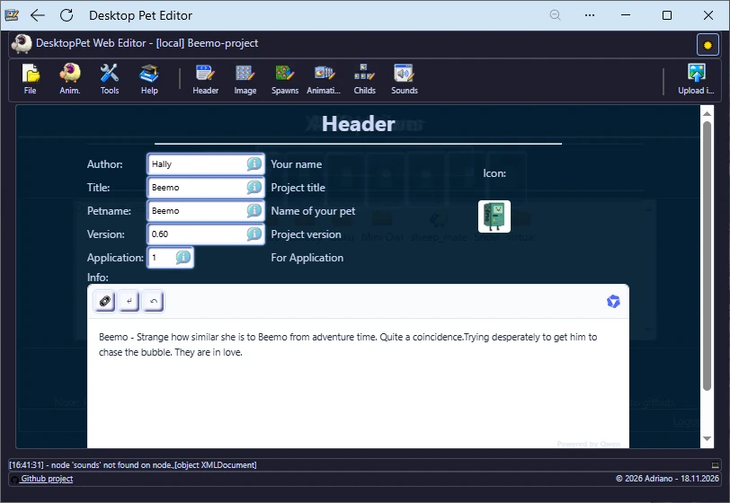
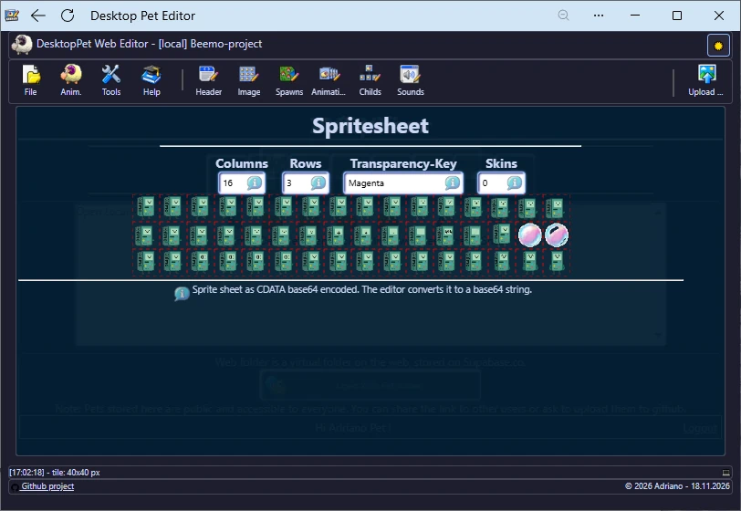
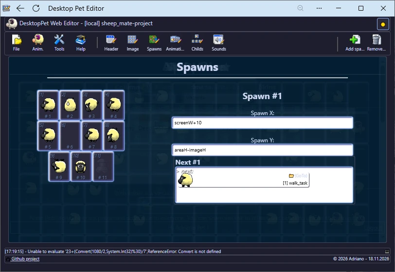

#  Tutorial: Animation Menu

A visual guide to the animation menu.

-  [Header block](../help/tutorial_editor_anim.md#Header)
-  [Spritesheet block](../help/tutorial_editor_anim.md#Spritesheet)
-  [Spawns block](../help/tutorial_editor_anim.md#Spawns)
-  [Animations block](../help/tutorial_editor_anim.md#Animations)
-  [Children block](../help/tutorial_editor_anim.md#Children)
-  [Sounds block](../help/tutorial_editor_anim.md#Sounds)
---

The editor provides a graphical interface for editing the XML file. It loads the XSD schema from GitHub to validate the structure and provide contextual help:

Move the pointer over an icon to display dynamic help. The help text is maintained in the [Resources folder](https://github.com/Adrianotiger/desktopPet/tree/master/Resources).

Most properties are saved directly in the XML. **Remember to save the XML from the File menu.**
Some properties, such as those in the animation block, are saved only after selecting `Save`.

## Header

### Author
Enter your name or nickname.
### Title
Enter the project name. This name should match the folder name and is displayed when users download the pet.
### Petname
Enter the pet name. It appears in the tray icon and when spawning a new pet.
### Version
Enter a version string, such as `0.1` for a beta or `1.0` for a released project.
### Application
This value is currently `1` and must remain unchanged. It will be increased to `2` if a future application version becomes incompatible with this XML format.
### Info
Enter the text displayed by the application's About menu. The supported formatting is limited:
- Use `[br]` for a line break.
- Use `[link:https://example.com]` for a link.
- Other HTML-style tags are not supported.
### Icon
Choose the icon displayed in Windows when the pet starts. The icon is stored as a Base64-encoded file in the XML.

Requirements:
- Use a Windows `.ico` file, not a PNG or JPG.
- Use a 48 x 48 pixel image.

If you upload a PNG, the editor converts it to the required format and resizes it to 48 x 48 pixels.

## Spritesheet

The spritesheet is stored as a Base64-encoded string in the XML file.
Select `Upload` to import a spritesheet image, then configure the following parameters:
### Columns/Rows
Enter the number of columns and rows in the spritesheet. The image dimensions must be exact multiples of the frame size.
For example, a 10 x 10 pixel frame cannot fit in a 98 x 100 pixel spritesheet. The editor displays an error when the dimensions are invalid.
An external image editor is currently required to prepare sprites.

### Transparency Key
DesktopPet uses a transparent color, implemented by Windows Forms, to render the spritesheet. The image must use one opaque, designated color for transparency; alpha channels and antialiasing are not supported.
Magenta is the default because it is uncommon in artwork. Another Windows color name may be selected; see [System.Windows.Media.Colors](https://learn.microsoft.com/en-us/dotnet/api/system.windows.media.colors).

### Skins
Use skins when the same animations are available in several color variants. Set this value to `0` or `1` for a single skin, or enter the number of skins to divide the spritesheet into corresponding groups.
For example, a 20 x 10 spritesheet contains 200 frames. With four skins, each skin has 50 frames. Add the animations only for the first skin; DesktopPet selects a random skin when the pet starts.

## Spawns

Configure the location where the pet appears and the animation that plays after spawning.

This block requires at least one animation.

###  Add Spawn
Select this button to add another spawn location. At least one spawn is required.
For multiple locations, use Probability to control how frequently each location is selected.

### Spawn X / Spawn Y
Set the spawn X and Y coordinates. Each field accepts a formula; select it to open the formula editor.

### Probability
Enter an integer weight for this spawn location. It is not a percentage; DesktopPet combines all weights into a probability distribution.
For example, if the total weight is 100, a weight of 1 selects this spawn once in approximately every 100 spawns.
