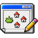

#  Tutorial: Animation Menu

A complete, visual guide to the animation menu functionality.

-  [Header block](../help/tutorial_editor_anim.md#Header)
-  [Spritesheet block](../help/tutorial_editor_anim.md#Spritesheet)
-  [Spawns block](../help/tutorial_editor_anim.md#Spawns)
-  [Animations block](../help/tutorial_editor_anim.md#Animations)
-  [Childs block](../help/tutorial_editor_anim.md#Childs)
-  [Sounds block](../help/tutorial_editor_anim.md#Sounds)  
  
---

The editor is just a GUI to edit the XML file. It loads the XSD file from Github to validate the structure and add tooltips on this editor:  
   
Move your mouse over the icon to see the dynamic help (located on https://github.com/Adrianotiger/desktopPet/tree/master/Resources).  

The most properties are saved directly on the XML. **Remember: you need to save the XML under the menu File!**  
Some properties are saved only if you presse the `save` button. For example in the `animation block`.

## Header  

  
### Author 
Your name or Nickname
### Title
The name of the project. This is also the name that should appear on the folder or when the user want to download your mate.
### Petname
The name of the pet. This name will appear in the tray icon, when you want to spawn a new pet.
### Version
A free text. Use something like 0.1 for a beta version. 1.0 if you want to publish it.
### Application
Currently `1` and must be stay 1. If a new application will be made and this XML is not anymore compatible, probably this will be increased to `2`.
### Info
A info block. This text will appear on the application, when the user press the `about` menu. It is really limited, so you can just use `[br]` for a new line or `[link:https://....]` for a link. Or just use the editor. Other tags are not parsed. No bold, no underline or so. Just text and line breaks.
### Icon
The icon to display on Windows when the pet is started. It is saved as base64-file inside the XML.  
Rules:
- it must be an icon (Windows icon, not png or jpg)
- must be 48x48  

  
If you upload a PNG, the editor will automatically convert it to the right format. If it has the wrong size, it will be resized to 48x48.

## Spritesheet
  

  
The spritesheet is saved as base64-string in the XML file.  
Press the `upload` button to import a new spritesheet image. Once uploaded you need to set the parameters for this image:  
### Columns/Rows
Set the quantity or columns and rows for your spritesheet. The editor will show an error bar if the image size is not a multiple of the cell size. If you have a tile with size 10x10, you can't have a spritesheet of 98x100 as a pixel is an integer and can't be 9.8.  
Maybe in future an image editor will be integrated in this editor, but at the moment you need another editor to edit your sprites. 

### Trasparency-Key
Windows is able to set a transparency-color in window-forms. This is used on the `desktopPet` to render transparency.  
Note: there is no alpha channel or opacity in the pixels, so don't try to add antialiasing or so, it will not work! There are 65'536 colors you can choose and exactly one will be used as transparency in Windows. Default is `magenta` as this is not used normally in images.  
You can choose another color, using a keyname. See [https://learn.microsoft.com/en-us/dotnet/api/system.windows.media.colors](https://learn.microsoft.com/en-us/dotnet/api/system.windows.media.colors)  

### Skins
Some animations have multiple skins. If you have a pet with 5-6 colors and they all have the same animations to play, you can write 5-6 pets or you can put them all in the same spritesheet and set this value.  
If this value is 0 or 1, there is only 1 skin.  
If you have 2 or more, the spritesheet is divided by this number. 
Example: spritesheet with 20x10 = 200 tiles. 4 skins, means 50 tiles for each skin.  
Animations have to get only the first skin. The application will then get a random skin, when the pet starts.

## Spawns
  

  
When the pet starts to play, it will be spawn somewhere on the screen.  
In this block, you can set where the pet should spawn and wich animation should be played once it is here.  

Note: This block can only be edited, if there are some animations. 

###  Add Spawn
Press this button, to create another spawn. You need at least 1 if you want to play animations.  
You can create multiple spawn. If you have more than 1, set the probability to choose if you want it as rare event or if it should spawn a lot of times there.  

### Spawn X / Spawn Y
Set the X and Y value to spawn. This box uses a formula. Click on this box to open the formula-editor. 

### Probability
The probability to see it in action. It is not a %-value, just an integer. At the end, all probability will be summed and this will be the 100%, so set the value to something you think could be ok.   
If the sum of all probabilities is 100 and you set 1, this spawn is played once every 100 spawns.  
