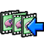
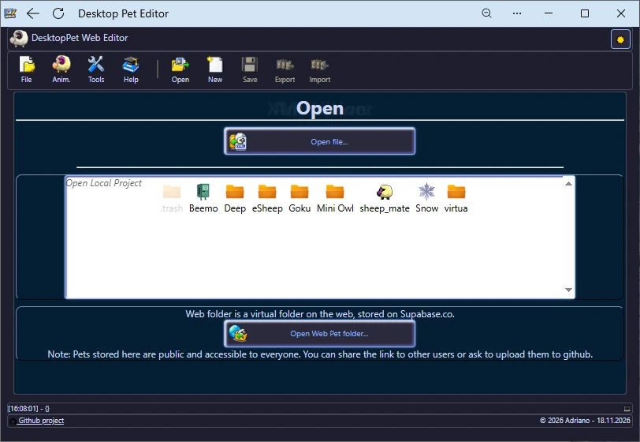
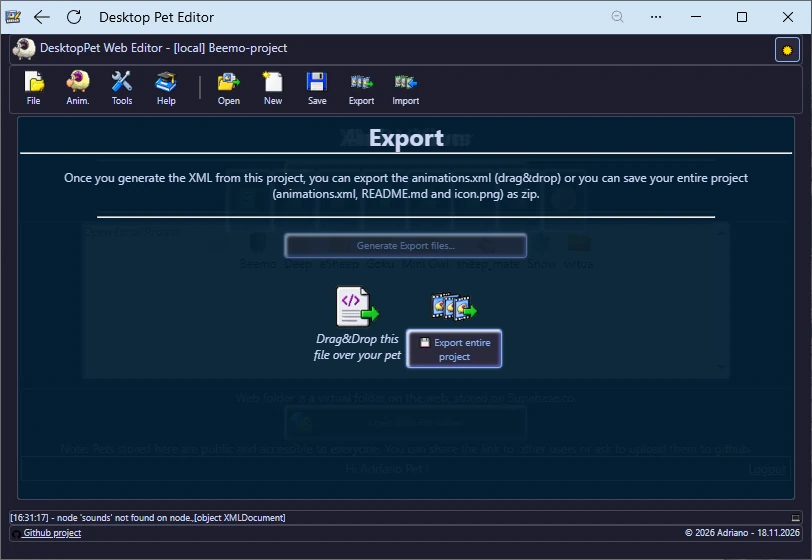

#  Tutorial: File Menu

A quick, visual guide to the file menu functionality.

-  [Open file or project](../help/tutorial_editor_file.md#Open)
-  [Start by template animation](../help/tutorial_editor_file.md#New)
-  [Save file or project](../help/tutorial_editor_file.md#Save)
-  [Export or test](../help/tutorial_editor_file.md#Export)
-  [Import XML](../help/tutorial_editor_file.md#Import)

## Open  

### Open a single xml
You can open a single file `animations.xml` and edit it. When you finished you have to save this file or export it.

### Open local project
You can also give access to a folder.    
If you open the `local Pet folder`, you have to give access to the entire local folder and the application can read and write any file on this folder.  
This works on Chrome, Edge and Opera. Does not work on Firefox or Safari as they didn't implemented this standard yet.

Once you granted the access, you will see your folders (if icon.png is present, the image of your animation): 
  

The folder handler will be stored in the application, so you don't need to select it on each start.  

### Open web project
Sometimes you want to test your pets and share them to your friends.  
This editor is connected to [supabase.com](https://supabase.com/). You have to access it over an account (currently only google is implemented), and you will get a space for up to 10 animations to share.  
It is in development, so you can just edit 1 mate (TestPet) and try the sharing link with the DesktopPet (version 2.01).  
You can work on it, like a local project. Once you save it, you will get the sharing link.  

  

Press on a project or open the animations.xml manually to load the XML in this editor.

## New

New will load a template with just 2-3 animations. Perfect to start a new animations-project.

## Save

### Save file as...

You can save the new animation with another name or you can save the animations.xml in your project folder.  

### Save local project 

If you opened a local project, you can overwrite your `animations.xml` or save it as copy (as this editor is still in beta).  
Selecting `Make a backup`, the current animations.xml will be saved in the trash folder with a increasing number. So you can recovery it if neccessary.  
`icon.png` and `README.md` can be generated over this tool if they are missing in your project. Or if you need to update the icon with a new one.

### Save web project  
If you opened a web project you will see something like this:  

You can update your project, not creating any new file or so. The same rules like on GitHub.  

**Github note:**
- to upload it to GitHub, you need a README.md, animations.xml and icon.png files.
- README.md and icon.png can be generated from this application if they are missing in the folder.
- animations-copy will have a number [YYMMDDXX].xml. Don't worry, they are not uploaded to GitHub!
- backuped animations are in the `.trash`folder. They also are not uploaded to GitHub.
- in future, it will be easy to add a pet to github, but I still need to implement this feature.

## Export
  

  
Once you generate the exporting files, you can drag&drop the generated animation directly to your current desktop pet.  
So you can test and see if everything is ok.  
You can also export the project as ZIP, ready to be uploaded to GitHub.  

## Import
  
Some XML can't be uploaded. For example the web-project is generated on the server and you need to use the XML as it is. If you have loaded a XML, you can import a new XML to replace the current animation.  
In future, you will be able to import also icons or spritesheets from other animations-files.  

At the moment, it is just used to replace your `testPet` animations-project from the web folder.