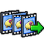
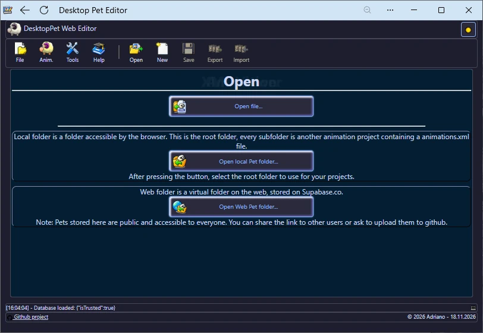
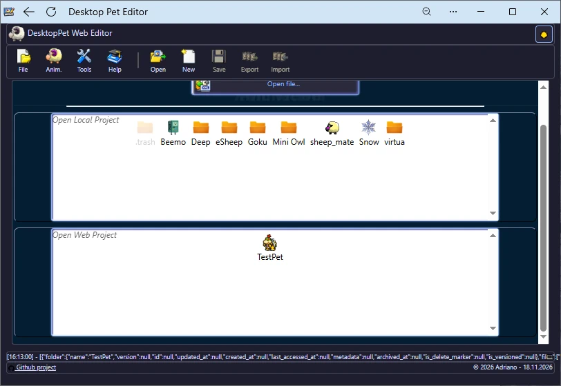
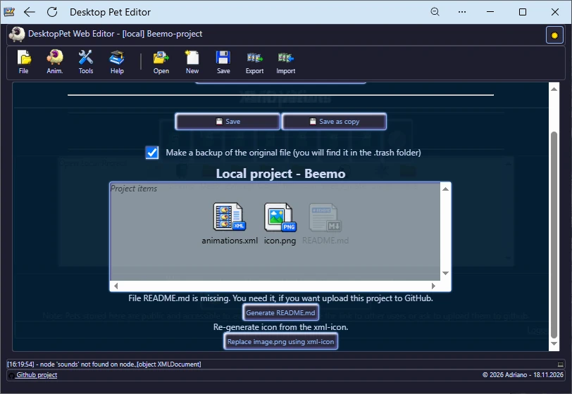
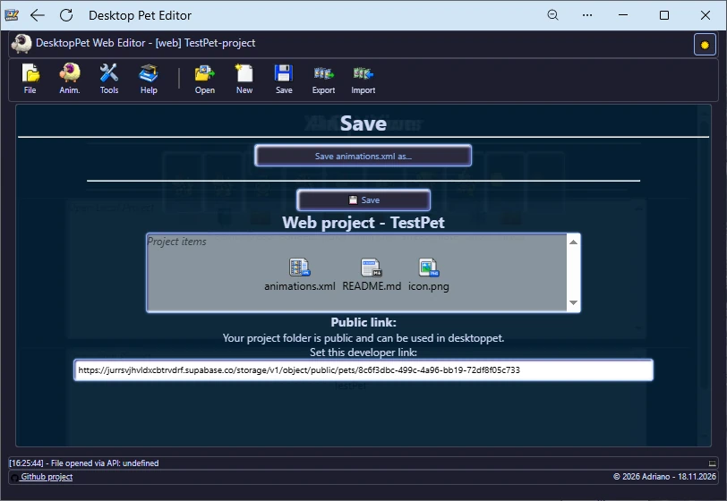

#  Tutorial: File Menu

A quick, visual guide to the file menu functionality.

-  [Open file or project](../help/tutorial_editor_file.md#Open)
-  [Start by template animation](../help/tutorial_editor_file.md#New)
-  [Save file or project](../help/tutorial_editor_file.md#Save)
-  [Export or test](../help/tutorial_editor_file.md#Export)
-  [Import XML](../help/tutorial_editor_file.md#Import)

## Open

### Open a single XML file
Open a single `animations.xml` file for editing. Save or export the file after making changes.

### Open local project
You can also open a local project folder. The application will request permission to read and write files in the selected folder.
Folder access is supported in Chrome, Edge, and Opera. Firefox and Safari do not currently support this standard.

After access is granted, DesktopPet displays the project folders. If `icon.png` is present, it is used as the project image:

The folder permission is stored by the application, so you do not need to select the folder each time.

### Open web project
The editor uses [Supabase](https://supabase.com/) to host projects for testing and sharing. Sign in with Google to create a workspace with up to ten pets.
This feature is in development. One pet, `TestPet`, can currently be edited and shared with DesktopPet 2.01.
Web projects use the same editing workflow as local projects. Saving a project creates a sharing link.

Select a project or open `animations.xml` manually to load it in the editor.

## New

New loads a template containing two or three animations. This is a suitable starting point for a new animation project.

## Save

### Save file as...

You can save the animation with a different name or save `animations.xml` in the project folder.

### Save local project

For a local project, you can overwrite `animations.xml` or save a copy.
Selecting `Make a backup` moves the current `animations.xml` to the `.trash` folder with an incrementing backup number.
The editor can generate `icon.png` or `README.md` when they are missing, or update `icon.png` with a new image.

### Save web project
For a web project, the save dialog provides the following options:

You can update the project without creating additional project files. GitHub project rules apply.

**GitHub note:**
- A GitHub upload requires `README.md`, `animations.xml`, and `icon.png`.
- The application can generate `README.md` and `icon.png` if they are missing.
- Animation backups use the `[YYMMDDXX].xml` format and are not uploaded to GitHub.
- Backups are stored in the `.trash` folder and are not uploaded to GitHub.
- Support for directly adding pets to GitHub is planned for a future release.

## Export

After generating the export files, drag and drop the animation onto the running DesktopPet application to test it.
You can also export the project as a ZIP archive ready for upload to GitHub.

## Import

Some XML files cannot be modified. For example, a server-generated web project must preserve its original XML structure. You can import an XML file to replace the currently loaded animation.
Future releases will support importing icons and spritesheets from other animation files.

At present, this operation replaces the `TestPet` animation project with a web folder project.