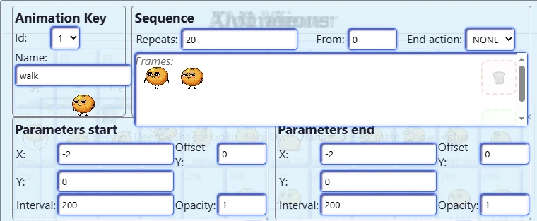
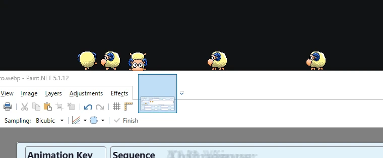

# App Tutorial: Introduction

The editor should be easy to use, but you need to know some simple rules before you start with your first pet.  
If you don't respect them, you will arrive at one point where you can't continue or the pet is not doing what you want.  

The entire project is saved in a single XML-file. Resources like spritesheet, icon and sounds are stored as base-64 strings directly in the XML.

## Basic rules

1. The entire project should have only **1 direction**.
2. Every move is described as **animation** and is a sequence of frames.
3. A sequence will end with a border-**detection**, gravity-**detection** or if all frames are played

## 1. Direction  
Every animation sequence described in your project has to be in the same direction.  
Normally from left to right (eSheep is from right to left, as it come from Japan).  
To move a pet, you need to set the `X-parameter` start and end. This will move the pet for `x` pixels on each frame.  
Check the [animation-tutorial](../help/tutorial_editor_anim.md#Animation) to find out how to edit it.
  

**Important: just set always a negative X (move left) or positive X (move right).**  
Once the pet reach the end of the screen, all animations written by you will be mirrored (with `End-Action:FLIP`) by the application 
and so all negative X will become positive. This is the most important rule to understand.

## 2. Sequence
The project has `animations`. An animation consists in a sequence of frames (like an animated gif).  
You describe this sequence, adding frames to play and setting the movement (x,y) and delay between the frames (interval).  
A project with 200 animations is a fantastic project! A project with just 10 animations will be boring for the end user ;) 

## 3. Sequence End
The pet will normally walk on the windows and taskbar, or climb screen border. The limit is up to you and your fantasy.  
  
The sequence can be interrupted or ended normally:  
- border detected: If a border is detected (pet, window or screen) you can choose the animation to play at this point. The animation will be stopped and the new animation (frame sequence will be played).  
- gravity detected: Your animation can also check for gravity. If no window, no taskbar and no screen is detected under your pet, the gravity-animation will be played automatically.  
- normal end: When the sequence is over, another animation is played. You can choose a random animation to play (adding many animations to this section).

That's all. If you understand this, you can start designing your pet!  

For every question or trouble, just use the discussion board on Github: https://github.com/Adrianotiger/desktopPet-Editor/discussions 

